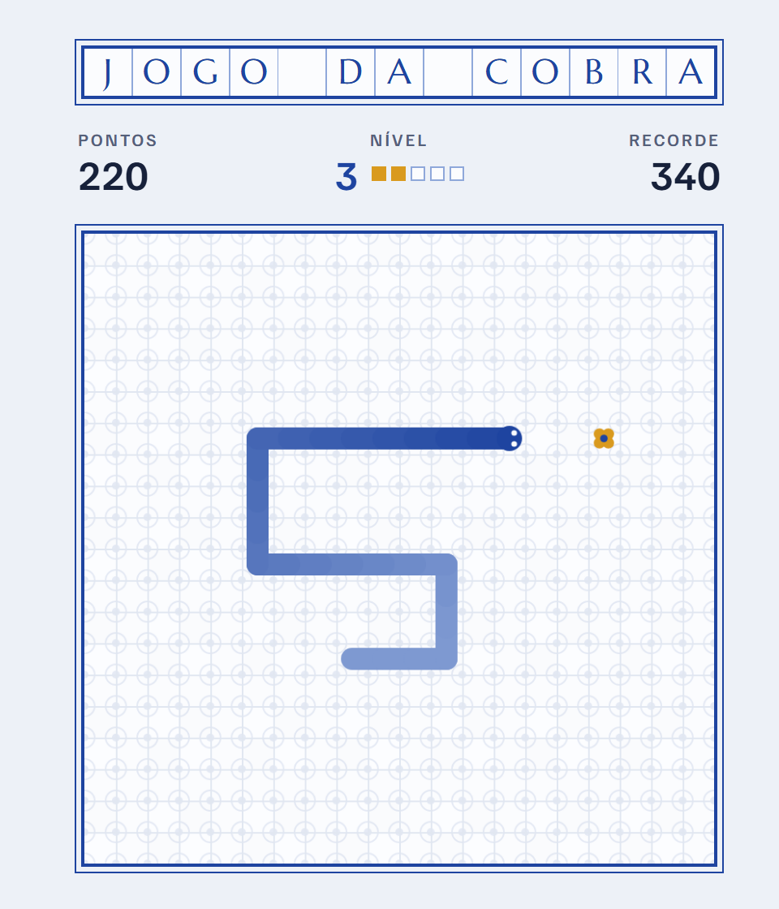

# Olá, eu sou o Gilberto 👋

### Engenheiro de Dados · Microsoft Fabric · Databricks · Power BI

Construo pipelines e lakehouses que transformam dado bruto em decisão, 
da ingestão ao modelo semântico que chega no dashboard.

---

## 🧭 Sobre mim

- 🏢 Trabalho com soluções de dados e BI na **Power BI Solutions**
- 🏗️ Desenho arquiteturas **lakehouse medalhão** (bronze → silver → gold) no **Microsoft Fabric** e no **Databricks**
- 🔁 Já migrei ambientes de **Hive Metastore para Unity Catalog** sem quebrar os relatórios em produção
- 🚦 Implanto **CI/CD para Power BI** (PBIP, aprovação por ambiente e deploy via API do Fabric)
- 📊 Modelagem dimensional e **Direct Lake** para Power BI rápido em grandes volumes
- 🤖 Uso agentes de IA (Claude Code, Spec Kit) para acelerar desenvolvimento com especificação e testes
- 🌱 Hoje estudando: Fabric Real-Time Intelligence, Data Activator e CI/CD com Fabric Git integration

## 🛠️ Stack

**Plataformas de dados** 

**Processamento e linguagens** 

-512BD4?style=flat-square&logo=dotnet&logoColor=white)

**Analytics e BI** 

**Engenharia e DevOps** 

## 🚀 Projetos em destaque

<table>
<tr>
<td width="50%" valign="top">

### ⚡ [Lakehouse de Geração Distribuída · ANEEL](https://github.com/gilbertosales/fabric-lakehouse-aneel)
Pipeline ponta a ponta no **Microsoft Fabric** sobre milhões de sistemas de micro e minigeração do Brasil. Arquitetura medalhão, LGPD por construção, quarentena de dados, modelo estrela em **Direct Lake** e CI com testes PySpark.

`Fabric` `PySpark` `Delta` `Power BI` `GitHub Actions`

</td>
<td width="50%" valign="top">

### 🔁 [Migração Hive → Unity Catalog](https://github.com/gilbertosales/Projeto-Unit-Catalog-Migra-o)
Script C# para Tabular Editor que reescreve, com regex, as conexões de datasets do Power BI do Databricks legado para o **Unity Catalog**, em lote e sem retrabalho manual.

`Databricks` `Unity Catalog` `Power BI` `C#`

</td>
</tr>
<tr>
<td width="50%" valign="top">

### 🚦 [Esteira CI/CD para Power BI](https://github.com/gilbertosales/powerbi-cicd-esteira)
Promoção **Dev → Homologação → Produção** com aprovação via MR, validação de PBIP/TMDL e deploy pela API do Fabric com `fabric-cicd` e Service Principal. Implantada num órgão público, com rollback testado.

`Power BI` `PBIP` `fabric-cicd` `GitLab CI` `Entra ID`

</td>
<td width="50%" valign="top">

### 📄 [Gera Documents](https://github.com/gilbertosales/gera-documents)
Documentação técnica em Markdown entregue como Word corporativo: análise de 25+ regras, correção automática, revisão de texto com IA (Claude) e frontend web local. 107 testes.

`Python` `python-docx` `Claude Code` `Spec Kit`

</td>
</tr>
<tr>
<td width="50%" valign="top">

### 🃏 [Spec-Driven Development na prática](https://github.com/gilbertosales/FirstProjectSpeckit)
Aplicação web construída com **Spec Kit** e agente de IA: constituição do projeto, especificação, plano e testes antes do código.

`Spec Kit` `IA` `JavaScript` `Python`

</td>
<td width="50%" valign="top">

### 🤖 [Quiz Claude Code · Verdadeiro ou Falso](https://github.com/gilbertosales/Quiz-claude)
Treinamento gamificado com 4 níveis, explicação e link para a documentação em cada resposta, e ranking global com regras validadas no banco (RPC, RLS e rate limit). 96 testes + E2E. **[▶ Jogar agora](https://quiz-claude-ten.vercel.app)**

`React` `TypeScript` `Supabase` `Vitest` `Playwright`

</td>
</tr>
</table>

📚 **Estudos:** [skills-for-fabric](https://github.com/gilbertosales/skills-for-fabric) ·
[fabric-samples](https://github.com/gilbertosales/fabric-samples) ·
[imersão Databricks](https://github.com/gilbertosales/imersao_databricks) ·
[roadmap de engenharia de dados](https://github.com/gilbertosales/data-engineering-roadmap)

## 🎮 Nas horas vagas

<picture>
  <source media="(prefers-color-scheme: dark)" srcset="https://raw.githubusercontent.com/gilbertosales/gilbertosales/output/github-contribution-grid-snake-dark.svg" />
  <source media="(prefers-color-scheme: light)" srcset="https://raw.githubusercontent.com/gilbertosales/gilbertosales/output/github-contribution-grid-snake.svg" />
  
</picture>

### 🐍 [Jogo da Cobrinha](https://gilbertosales.github.io/jogo_cobra/)
Snake clássico em HTML e JavaScript puro, com níveis que aceleram a cobra e placar de recordes.

▶️ [Jogar agora](https://gilbertosales.github.io/jogo_cobra/) · 💻 [Ver código](https://github.com/gilbertosales/jogo_cobra)

## 📈 GitHub

---

💬 Aberto a conversas sobre **engenharia de dados, Fabric e analytics**. Me chama no [LinkedIn](https://www.linkedin.com/in/gilberto-gomes-de-sales-3a979651)!

